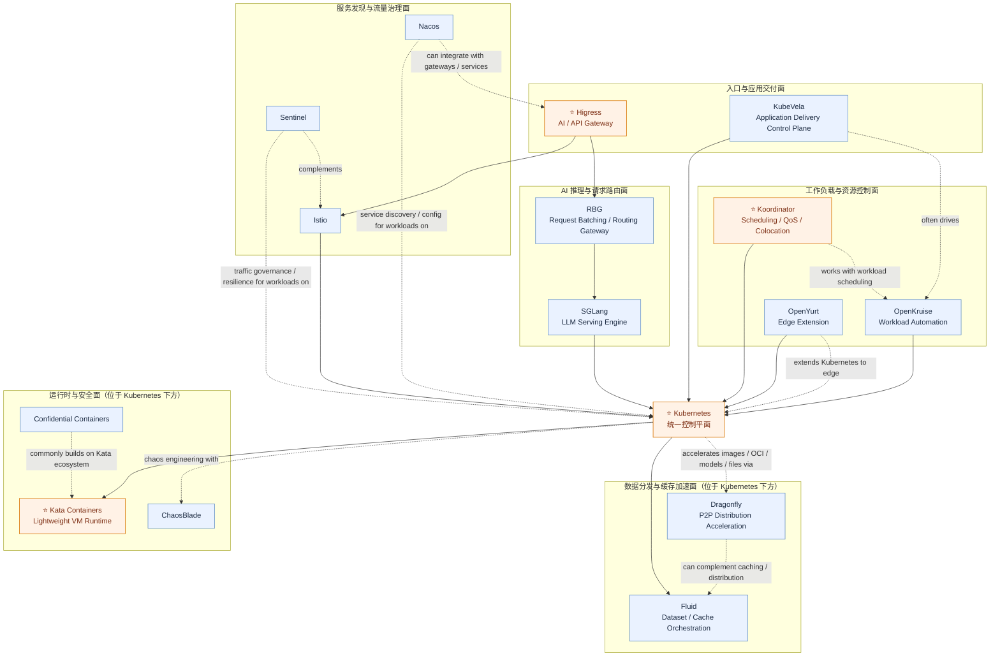

# 阿里巴巴（Alibaba）云原生开源案例（全景版）

## 一句话结论

阿里云原生开源横跨 **网关（Higress）、应用交付（KubeVela / OpenKruise）、混部调度（Koordinator）、边缘（OpenYurt）、安全运行时（Kata）与数据分发（Fluid / Dragonfly）**；AI 侧以 SGLang / RBG 补齐推理引擎与批路由。

## 重点整理

- `Higress`：CNCF Sandbox（API / AI Gateway）
- `Kata Containers`：轻量 VM 安全运行时
- `SGLang / RBG`：LLM Serving 与请求批处理 / 路由

## 可编辑架构分层图（Mermaid）

## 发起/主导项目（代表）

- [higress-group/higress](https://github.com/higress-group/higress)
- [openyurtio/openyurt](https://github.com/openyurtio/openyurt)
- [kata-containers/kata-containers](https://github.com/kata-containers/kata-containers)
- [koordinator-sh/koordinator](https://github.com/koordinator-sh/koordinator)
- [chaosblade-io/chaosblade](https://github.com/chaosblade-io/chaosblade)
- [confidential-containers/confidential-containers](https://github.com/confidential-containers/confidential-containers)
- [openkruise/kruise](https://github.com/openkruise/kruise)
- [kubevela/kubevela](https://github.com/kubevela/kubevela)
- [fluid-cloudnative/fluid](https://github.com/fluid-cloudnative/fluid)
- [dragonflyoss/dragonfly](https://github.com/dragonflyoss/dragonfly)
- [alibaba/nacos](https://github.com/alibaba/nacos)
- [alibaba/Sentinel](https://github.com/alibaba/Sentinel)

## 补充：AI 推理生态项目（本图纳入）

- [sgl-project/sglang](https://github.com/sgl-project/sglang)
- [sgl-project/rbg](https://github.com/sgl-project/rbg)

## 深度参与项目（代表）

- [kubernetes/kubernetes](https://github.com/kubernetes/kubernetes)
- [istio/istio](https://github.com/istio/istio)
