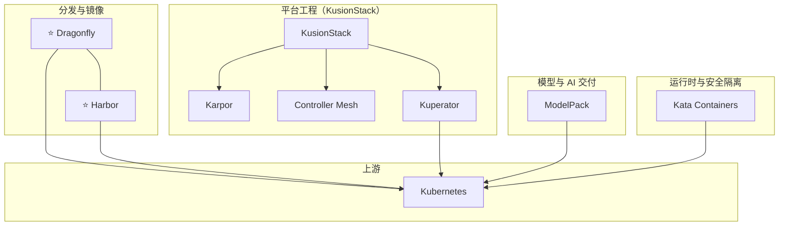

# 蚂蚁集团（Ant Group）云原生开源案例（全景版）

## 一句话结论

蚂蚁开源主线是 **镜像/内容分发（Dragonfly、Harbor）+ 平台工程（KusionStack）+ 模型打包（ModelPack）+ 安全运行时（Kata）**，并持续参与 Kubernetes 上游。

## 分层视角

| 层 | 代表项目 |
| --- | --- |
| 分发与镜像 | Dragonfly, Harbor |
| 平台工程与运维 | KusionStack（Karpor / Controller Mesh / Kuperator） |
| 模型与 AI 交付 | ModelPack |
| 运行时与安全隔离 | Kata Containers |
| 上游参与 | Kubernetes |

## 可编辑全景图（Mermaid）

## 发起/主导项目（代表）

- [dragonflyoss/dragonfly](https://github.com/dragonflyoss/dragonfly)
- [goharbor/harbor](https://github.com/goharbor/harbor)
- [KusionStack/community](https://github.com/KusionStack/community)
- [KusionStack/karpor](https://github.com/KusionStack/karpor)
- [KusionStack/controller-mesh](https://github.com/KusionStack/controller-mesh)
- [KusionStack/kuperator](https://github.com/KusionStack/kuperator)
- [modelpack（GitHub Org）](https://github.com/modelpack/)
- [modelpack/community](https://github.com/modelpack/community)
- [kata-containers/kata-containers](https://github.com/kata-containers/kata-containers)

## 深度参与项目（代表）

- [kubernetes/kubernetes](https://github.com/kubernetes/kubernetes)
