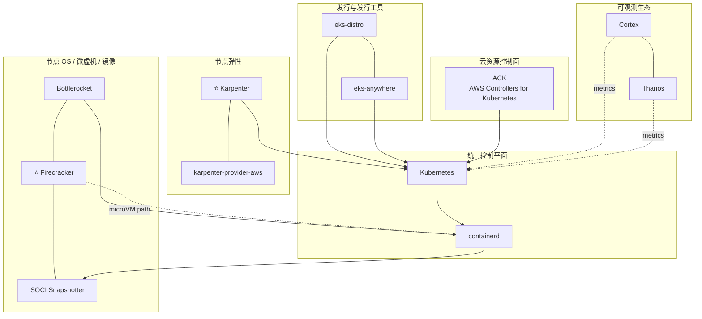

# AWS 云原生开源案例（全景版）

## 一句话结论

AWS 的云原生开源重心在 **EKS 发行与节点供给**：从发行版（EKS Distro / Anywhere）到弹性节点（Karpenter）、微虚机（Firecracker）、容器 OS（Bottlerocket）和镜像懒加载（SOCI），把「跑 Kubernetes 的那一层」开源出来。

## 分层视角

| 层 | 代表项目 |
| --- | --- |
| 发行与发行工具 | `eks-distro`, `eks-anywhere` |
| 节点弹性供给 | `karpenter`, `karpenter-provider-aws` |
| 云资源 CRD 控制面 | AWS Controllers for Kubernetes（ACK） |
| 节点 OS / 微虚机 | `bottlerocket`, `firecracker` |
| 镜像与启动加速 | `soci-snapshotter` |
| 可观测生态参与 | Cortex, Thanos |
| 数据基础设施外溢 | Valkey |

## 可编辑全景图（Mermaid）

## 发起/主导项目（代表）

- [aws/eks-distro](https://github.com/aws/eks-distro)
- [aws/eks-anywhere](https://github.com/aws/eks-anywhere)
- [kubernetes-sigs/karpenter](https://github.com/kubernetes-sigs/karpenter)
- [aws/karpenter-provider-aws](https://github.com/aws/karpenter-provider-aws)
- [aws-controllers-k8s/community](https://github.com/aws-controllers-k8s/community)
- [bottlerocket-os/bottlerocket](https://github.com/bottlerocket-os/bottlerocket)
- [firecracker-microvm/firecracker](https://github.com/firecracker-microvm/firecracker)
- [awslabs/soci-snapshotter](https://github.com/awslabs/soci-snapshotter)

## 深度参与 / 周边

- [kubernetes/kubernetes](https://github.com/kubernetes/kubernetes)
- [containerd/containerd](https://github.com/containerd/containerd)
- [cortexproject/cortex](https://github.com/cortexproject/cortex)
- [thanos-io/thanos](https://github.com/thanos-io/thanos)
- [valkey-io/valkey](https://github.com/valkey-io/valkey)
