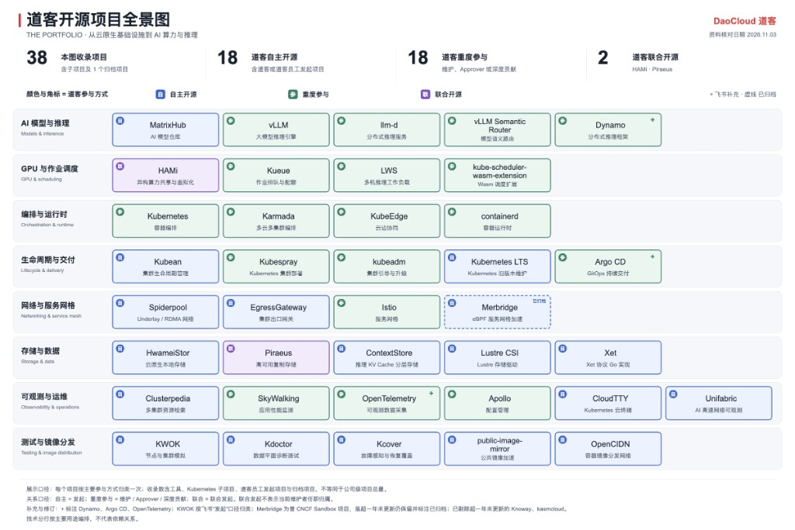
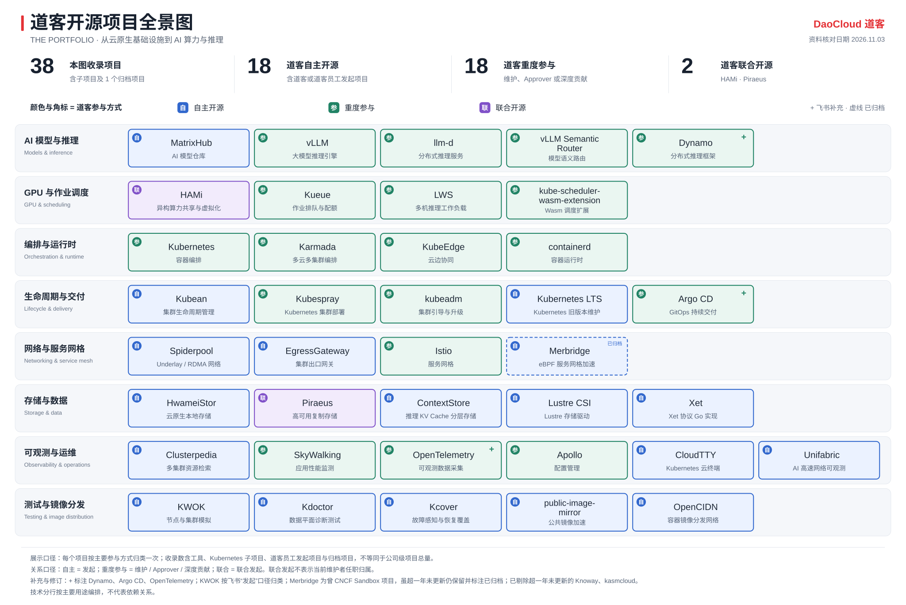
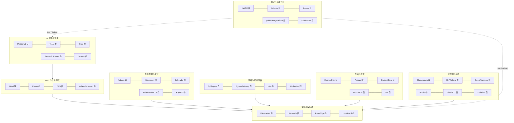
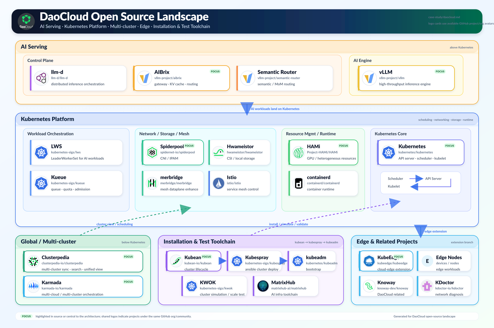
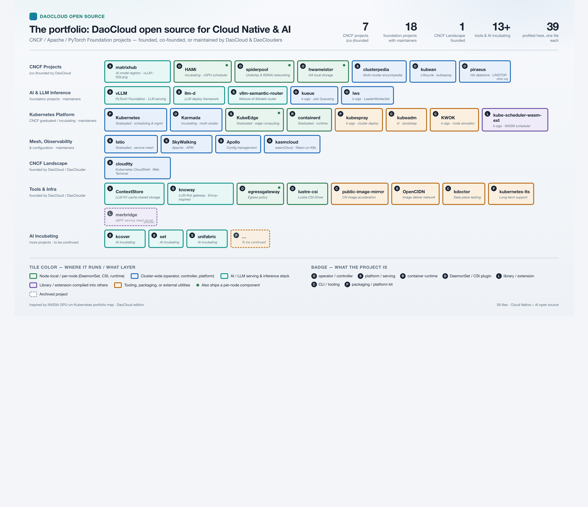

# DaoCloud 云原生开源案例（Portfolio 全景版）

## 参考输入

- 道客开源项目全景图（资料核对日期 2026.11.03）
- SVG：[`diagrams/daocloud-open-source-portfolio.svg`](../diagrams/daocloud-open-source-portfolio.svg)
- 架构关系旧图（保留）：[`diagrams/daocloud-open-source-landscape.svg`](../diagrams/daocloud-open-source-landscape.svg)
- DaoCloud Profile：https://github.com/DaoCloud/.github/blob/main/profile/README.md

## 一句话结论

DaoCloud 开源不是「几个 CNCF 项目」，而是从云原生基础设施一路铺到 AI 算力与推理的 **38** 个组件组合：其中 **18** 项自主开源、**18** 项重度参与、**2** 项联合开源（`HAMi`、`Piraeus`）。

| 统计 | 数量 | 说明 |
| --- | --- | --- |
| 本图收录项目 | 38 | 含子项目；含 1 个归档（Merbridge） |
| 道客自主开源 | 18 | 含道客或道客员工发起 |
| 道客重度参与 | 18 | Maintainer / Approver / 深度贡献 |
| 道客联合开源 | 2 | HAMi · Piraeus |

## Portfolio：八层组件地图

矢量版（可点进 GitHub）：

### 图例（参与方式）

| 角标 | 含义 |
| --- | --- |
| 自（蓝） | 自主开源：道客或道客员工发起 |
| 参（绿） | 重度参与：维护、Approver 或深度贡献 |
| 联（紫） | 联合开源：与伙伴共同发起 |
| 虚线边框 | 已归档（如 Merbridge，曾 CNCF Sandbox） |
| + | 飞书补充条目 |

项目按主归属只出现一次；Knoway、kasmcloud 等停更超一年的未列入本图。

### 八层清单

| 层 | 项目（角标） |
| --- | --- |
| AI 模型与推理 | MatrixHub（自）, vLLM（参）, llm-d（参）, vLLM Semantic Router（参）, Dynamo+（参） |
| GPU 与作业调度 | HAMi（联）, Kueue（参）, LWS（参）, kube-scheduler-wasm-extension（参） |
| 编排与运行时 | Kubernetes（参）, Karmada（参）, KubeEdge（参）, containerd（参） |
| 生命周期与交付 | Kubean（自）, Kubespray（参）, kubeadm（参）, Kubernetes LTS（自）, Argo CD+（参） |
| 网络与服务网格 | Spiderpool（自）, EgressGateway（自）, Istio（参）, Merbridge（自，归档） |
| 存储与数据 | HwameiStor（自）, Piraeus（联）, ContextStore（自）, Lustre CSI（自）, Xet（自） |
| 可观测与运维 | Clusterpedia（自）, SkyWalking（参）, OpenTelemetry+（参）, Apollo（参）, CloudTTY（自）, Unifabric（自） |
| 测试与镜像分发 | KWOK+（自）, Kdoctor（自）, Kcover（自）, public-image-mirror（自）, OpenCIDN（自） |

### 可编辑分层图（Mermaid）

## 架构关系图（旧版，保留）

偏「AI Serving × Kubernetes Platform × Multi-cluster × Edge」控制关系，可与 Portfolio 对照阅读：

## NVIDIA 风格对照图（可选）

另一聊天按 NVIDIA GPU-on-Kubernetes portfolio 信息图风格做的英文版（按基金会归属分行）：

## 项目清单（按层 + 参与方式）

### AI 模型与推理

- [matrixhub-ai/matrixhub](https://github.com/matrixhub-ai/matrixhub)（自）
- [vllm-project/vllm](https://github.com/vllm-project/vllm)（参）
- [llm-d/llm-d](https://github.com/llm-d/llm-d)（参）
- [vllm-project/semantic-router](https://github.com/vllm-project/semantic-router)（参）
- [ai-dynamo/dynamo](https://github.com/ai-dynamo/dynamo)（参）

### GPU 与作业调度

- [Project-HAMi/HAMi](https://github.com/Project-HAMi/HAMi)（联）
- [kubernetes-sigs/kueue](https://github.com/kubernetes-sigs/kueue)（参）
- [kubernetes-sigs/lws](https://github.com/kubernetes-sigs/lws)（参）
- [kubernetes-sigs/kube-scheduler-wasm-extension](https://github.com/kubernetes-sigs/kube-scheduler-wasm-extension)（参）

### 编排 / 生命周期 / 网络 / 存储

- [kubernetes/kubernetes](https://github.com/kubernetes/kubernetes)（参）
- [karmada-io/karmada](https://github.com/karmada-io/karmada)（参）
- [kubeedge/kubeedge](https://github.com/kubeedge/kubeedge)（参）
- [containerd/containerd](https://github.com/containerd/containerd)（参）
- [kubean-io/kubean](https://github.com/kubean-io/kubean)（自）
- [kubernetes-sigs/kubespray](https://github.com/kubernetes-sigs/kubespray)（参）
- [klts-io/kubernetes-lts](https://github.com/klts-io/kubernetes-lts)（自）
- [spidernet-io/spiderpool](https://github.com/spidernet-io/spiderpool)（自）
- [spidernet-io/egressgateway](https://github.com/spidernet-io/egressgateway)（自）
- [hwameistor/hwameistor](https://github.com/hwameistor/hwameistor)（自）
- [piraeusdatastore/piraeus](https://github.com/piraeusdatastore/piraeus)（联）
- [DaoCloud/ContextStore](https://github.com/DaoCloud/ContextStore)（自）
- [luskits/luscsi](https://github.com/luskits/luscsi)（自 · Lustre CSI）
- [wzshiming/xet](https://github.com/wzshiming/xet)（自）
- [merbridge/merbridge](https://github.com/merbridge/merbridge)（自 · 归档）

### 可观测 / 测试 / 镜像

- [clusterpedia-io/clusterpedia](https://github.com/clusterpedia-io/clusterpedia)（自）
- [cloudtty/cloudtty](https://github.com/cloudtty/cloudtty)（自）
- [unifabric-io/unifabric](https://github.com/unifabric-io/unifabric)（自）
- [kubernetes-sigs/kwok](https://github.com/kubernetes-sigs/kwok)（自）
- [kdoctor-io/kdoctor](https://github.com/kdoctor-io/kdoctor)（自）
- [BaizeAI/kcover](https://github.com/BaizeAI/kcover)（自）
- [DaoCloud/public-image-mirror](https://github.com/DaoCloud/public-image-mirror)（自）
- [OpenCIDN/ocimirror](https://github.com/OpenCIDN/ocimirror)（自）
- [apache/skywalking](https://github.com/apache/skywalking)（参）
- [open-telemetry](https://github.com/open-telemetry)（参）
- [apolloconfig/apollo](https://github.com/apolloconfig/apollo)（参）
- [argoproj/argo-cd](https://github.com/argoproj/argo-cd)（参）
- [istio/istio](https://github.com/istio/istio)（参）

## 超节点案例：Shanghai Cube

Shanghai Cube 是 DaoCloud 参与的国产高密度超节点整柜，不是开源仓库。2025-03-21 由上海模合信息科技联合沐曦、云合智网、道客云、立讯精密等发布。

- **硬件**：单柜 128 张沐曦曦云 C550，液冷。
- **DaoCloud 的部分**：定制国产操作系统，以及面向高密度国产算力的调度管理。
- **已公开工作负载**：DeepSeek 671B 满血版推理等。

细节见 [超节点（SuperNode）](../docs/hardware/supernode.md)。公开来源：
[Shanghai Cube 发布](https://d.run/news/i80bp6njjsg0yhxat1rgbvb7)、
[异构 GPU 优化实践](https://github.com/DaoCloud/DaoCloud-docs/blob/main/docs/zh/docs/blogs/2026/optimize-gpu.md)。
