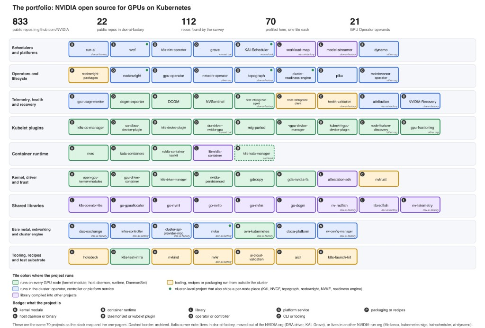
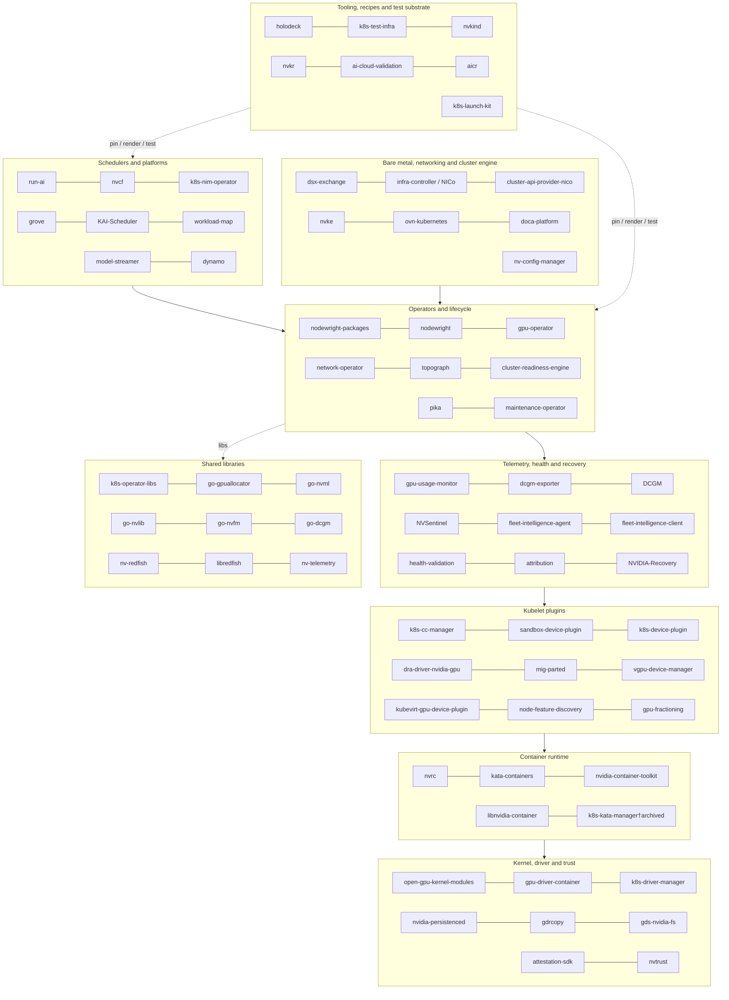
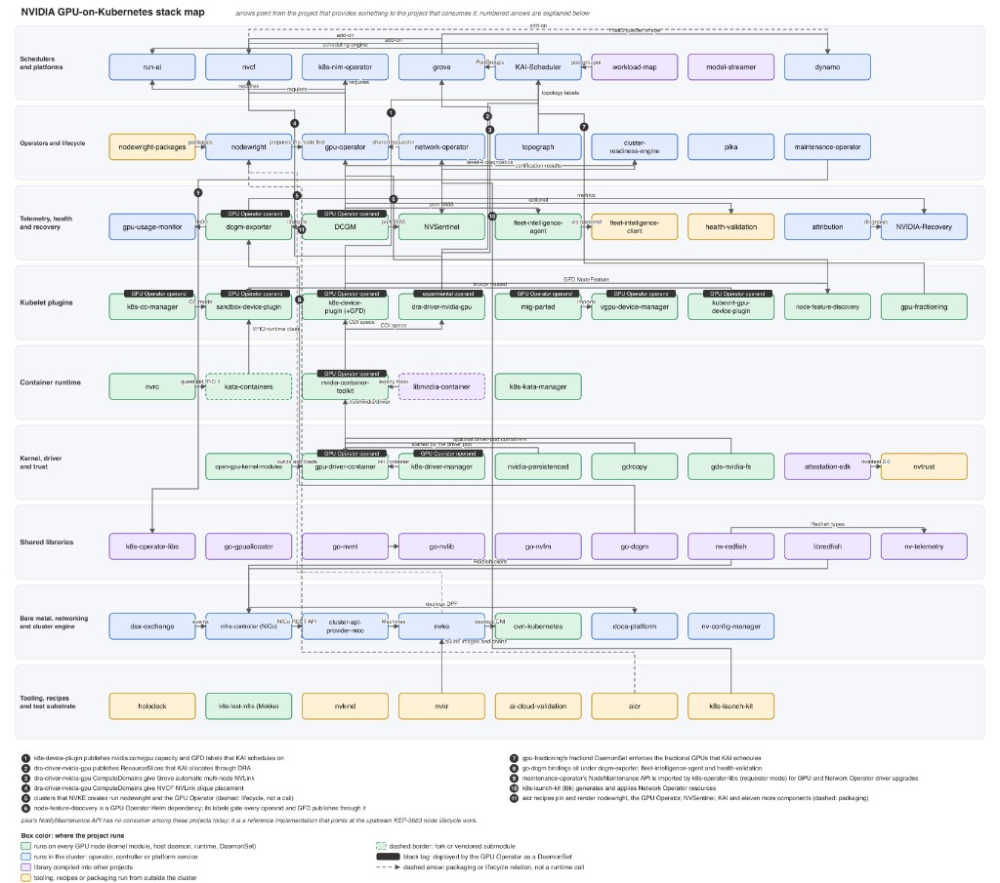
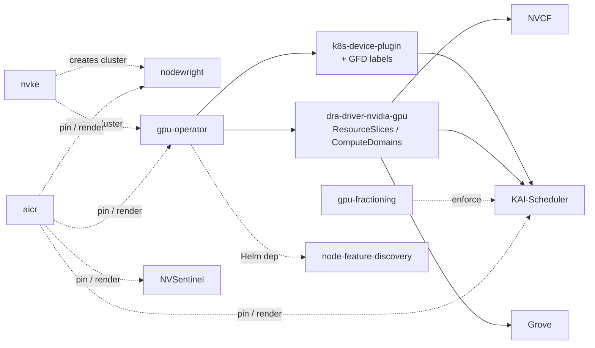
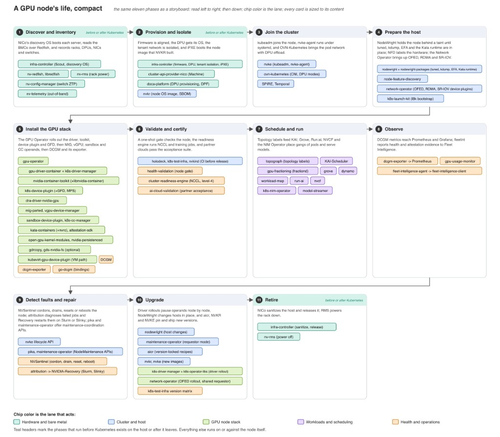
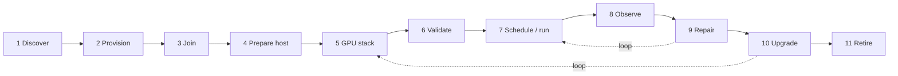

# NVIDIA 云原生开源案例（GPU-on-Kubernetes 全景版）

## 参考输入

- [dims @ X：NVIDIA open source for GPUs on Kubernetes](https://x.com/dims/status/2117233275098063066)
  （KubeCon 相关分享：portfolio / stack map / GPU node life）
- 当前仓库已有 NVIDIA 相关文档与清单

## 一句话结论

NVIDIA 在 Kubernetes 上的开源不是「几个 Operator」，而是一条从裸金属发现、节点准备、GPU 栈安装、调度运行，到观测、故障修复与升级退役的完整栈；公开盘点约 **70** 个组件（`github.com/NVIDIA` 833 个公开仓库中筛出），其中约 **21** 个是 GPU Operator operands。

| 统计 | 数量 |
| --- | --- |
| `github.com/NVIDIA` 公开仓库 | 833 |
| `dsx-ai-factory` 公开仓库 | 22 |
| 调研命中仓库 | 112 |
| 本图刻画组件（一格一个） | 70 |
| GPU Operator operands | 21 |

## Portfolio：九层组件地图



### 图例（运行位置 / 形态）

| 颜色 | 含义 |
| --- | --- |
| 绿 | 跑在每个 GPU 节点（内核模块、host daemon、runtime、DaemonSet） |
| 蓝 | 跑在集群内（operator / controller / platform service） |
| 紫 | 编进其他项目的共享库 |
| 黄 | 集群外的 tooling / recipes / packaging |
| 绿点 | 集群级项目，同时下发 per-node 组件 |

| 徽章 | 含义 |
| --- | --- |
| K | Kernel module |
| H | Host daemon / binary |
| R | Container runtime |
| D | DaemonSet / kubelet plugin |
| L | Library |
| O | Operator / controller |
| S | Platform service |
| C | CLI / tooling |
| P | Packaging / recipes |

虚线边框：归档项目（如 `k8s-kata-manager`）。角注：`dsx-ai-factory`、`moved out`（已迁出 NVIDIA org）、`other org`（Mellanox / kubernetes-sigs 等）。

### 九层清单

| 层 | 代表项目 |
| --- | --- |
| Schedulers and platforms | `run-ai`, `nvcf`, `k8s-nim-operator`, `grove`*, `KAI-Scheduler`*, `workload-map`, `model-streamer`, `dynamo`† |
| Operators and lifecycle | `nodewright-packages`, `nodewright`, `gpu-operator`, `network-operator`†, `topograph`, `cluster-readiness-engine`, `pika`, `maintenance-operator`† |
| Telemetry, health and recovery | `gpu-usage-monitor`, `dcgm-exporter`, `DCGM`, `NVSentinel`, `fleet-intelligence-agent`, `fleet-intelligence-client`, `health-validation`, `attribution`, `NVIDIA-Recovery` |
| Kubelet plugins | `k8s-cc-manager`, `sandbox-device-plugin`, `k8s-device-plugin`, `dra-driver-nvidia-gpu`*, `mig-parted`, `vgpu-device-manager`, `kubevirt-gpu-device-plugin`, `node-feature-discovery`†, `gpu-fractioning`† |
| Container runtime | `nvrc`, `kata-containers`, `nvidia-container-toolkit`, `libnvidia-container`, `k8s-kata-manager`（archived） |
| Kernel, driver and trust | `open-gpu-kernel-modules`, `gpu-driver-container`, `k8s-driver-manager`, `nvidia-persistenced`, `gdrcopy`, `gds-nvidia-fs`, `attestation-sdk`, `nvtrust` |
| Shared libraries | `k8s-operator-libs`, `go-gpuallocator`, `go-nvml`, `go-nvlib`, `go-nvfm`, `go-dcgm`, `nv-redfish`, `libredfish`, `nv-telemetry` |
| Bare metal, networking and cluster engine | `dsx-exchange`, `infra-controller`（NICo）, `cluster-api-provider-nico`, `nvke`, `ovn-kubernetes`†, `doca-platform`, `nv-config-manager` |
| Tooling, recipes and test substrate | `holodeck`, `k8s-test-infra`（Mokka）, `nvkind`, `nvkr`, `ai-cloud-validation`, `aicr`, `k8s-launch-kit` |

\* moved out　† other org；未标注但属 `dsx-ai-factory` 的多为工厂内部/关联 org 仓库（如 `run-ai`、`topograph`、`fleet-intelligence-*`、`nvke` 等）。

### 可编辑分层图（Mermaid）



## Stack map：依赖与关键连线



实线：运行时依赖。虚线：打包 / 生命周期关系（不是 runtime call）。黑色标签：由 GPU Operator 以 DaemonSet 下发。虚线边框：fork / vendored submodule。

### 关键连线（图中编号）

1. `k8s-device-plugin` 发布 capacity / GFD 标签，供 `KAI-Scheduler` 调度。
2. `dra-driver-nvidia-gpu` 发布 `ResourceSlices`，`KAI` 经 DRA 分配。
3. DRA `ComputeDomains` 让 `Grove` 自动拿到多节点 NVLink。
4. 同一套 `ComputeDomains` 支撑 `NVCF` 的 NVLink clique placement。
5. `NVKE` 建出的集群会跑 `nodewright` + `GPU Operator`。
6. `node-feature-discovery` 是 `GPU Operator` 的 Helm 依赖。
7. `gpu-fractioning` 的 fractional DaemonSet 落实 `KAI` 调度出的分数 GPU。
8. `go-dcgm` 坐在 `dcgm-exporter`、`fleet-intelligence-agent`、`health-validation` 之下。
9. `maintenance-operator` 的 NodeMaintenance API 被 `k8s-operator-libs` 引入，服务 GPU / Network 驱动升级。
10. `k8s-launch-kit`（IIR）生成并下发 `Network Operator` 资源。
11. `aicr` recipes 锁定并渲染 `nodewright`、`GPU Operator`、`NVSentinel`、`KAI` 等十余个组件。

### 调度 / DRA / Operator 主链路（精简）



## GPU 节点生命周期（11 步）



从发现到退役，把上面九层串成一条时间线。1 / 2 / 11 发生在「Kubernetes 尚未存在于该主机」或「节点已离开集群」阶段。

| # | 阶段 | 做什么 | 主要组件 |
| --- | ---: | --- | --- |
| 1 | Discover and Inventory | NICo discovery OS 启动，经 Redfish 读 BMC，登记机架 / DPU / NIC / 交换机 | `infra-controller`, `nv-redfish`, `libredfish`, `nv-rms`, `nv-config-manager`, `nv-telemetry` |
| 2 | Provision and Isolate | 对齐固件、给 DPU 装 OS、租户网络隔离，iPXE 拉起 `nvkr` 构建的节点镜像 | `infra-controller`, `cluster-api-provider-nico`, `doca-platform`, `nvkr` |
| 3 | Join the Cluster | kubeadm 入群，`nvke-agent` 跑在 systemd，OVN-Kubernetes + DPU offload 拉起 Pod 网络 | `nvke`, `ovn-kubernetes`, SPIRE, Temporal |
| 4 | Prepare the Host | NodeWright 用 taint 挡住节点直到 tuned / kdump / EFA / Kata 就绪；NFD 打硬件标签；Network Operator 拉起 OFED / RDMA / SR-IOV | `nodewright` + `nodewright-packages`, `node-feature-discovery`, `network-operator`, `k8s-launch-kit` |
| 5 | Install the GPU Stack | GPU Operator 滚动安装 driver / toolkit / device plugin / GFD，再装 MIG / vGPU / sandbox / CC operands，以及 DCGM | `gpu-operator`, `gpu-driver-container`, `k8s-driver-manager`, `nvidia-container-toolkit`, `k8s-device-plugin`, `dra-driver-nvidia-gpu`, `mig-parted`, `vgpu-device-manager`, `sandbox-device-plugin`, `k8s-cc-manager`, `kata-containers` + `nvrc`, `DCGM`, `dcgm-exporter`, … |
| 6 | Validate and Certify | 节点 one-shot gate、NCCL / 训练作业 readiness、合作云验收套件 | `holodeck`, `k8s-test-infra`, `nvkind`, `health-validation`, `cluster-readiness-engine`, `ai-cloud-validation` |
| 7 | Schedule and Run | 拓扑标签喂给 KAI；Grove / Run:ai / NVCF / NIM Operator 放置 gang 与模型服务 | `topograph`, `KAI-Scheduler`, `gpu-fractioning`, `grove`, `dynamo`, `workload-map`, `run-ai`, `nvcf`, `k8s-nim-operator`, `model-streamer` |
| 8 | Observe | DCGM 指标进 Prometheus / Grafana；fleet-int 上报健康与 attestation | `dcgm-exporter`, `gpu-usage-monitor`, `fleet-intelligence-agent` → `fleet-intelligence-client` |
| 9 | Detect Faults and Repair | NVSentinel cordon / drain / reset / reboot；attribution 诊断失败作业，Recovery 在Slurm / Slinky 侧重启；pika / maintenance-operator 协调维护 | `nvke` lifecycle API, `pika`, `maintenance-operator`, `NVSentinel`, `attribution`, `NVIDIA-Recovery` |
| 10 | Upgrade | 驱动滚动按节点暂停 operands；NodeWright 原地改主机；aicr / nvkr / nvke 锁定并下发新版本 | `nodewright`, `maintenance-operator`, `aicr`, `nvkr`, `nvke`, `k8s-driver-manager` + `k8s-operator-libs`, `network-operator`, `k8s-test-infra` |
| 11 | Retire | NICo 清理主机并释放；RMS 给机架下电 | `infra-controller`, `nv-rms` |



## 补充主线：Dynamo / Grove / KAI / KVBM / KVCR

Portfolio 把「GPU 节点如何进集群、如何被运维」画全了；推理服务侧仍可用这条更细的控制面主线理解：

```text
Dynamo -> Grove -> KAI Scheduler -> GPU DRA Driver
          \-> KVBM -> NIXL
          \-> KV Router -> KVCR -> NIXL
```

| 组件 | 位置 | 主要职责 |
| --- | --- | --- |
| `Dynamo` | Schedulers and platforms | distributed inference control plane（`DGDR/DGD`、Planner、Router、Profiler 等） |
| `Grove` | Schedulers and platforms | 用 `PodCliqueSet / PodGang` 把 prefill / decode / router / worker 收成单个对象；吃 DRA ComputeDomains |
| `KAI Scheduler` | Schedulers and platforms | gang、拓扑、层次队列、公平性与 DRA；落 Grove / fractioning 的放置意图 |
| `KVBM` | Dynamo 内 | KV block 生命周期与分层 offload，和 `NIXL` 构成 KV state plane |
| `KVCR` | 独立仓库 | 按 Router hints 管理本地 DRAM / SSD / 对象存储驻留与跨节点搬运（活跃开发中） |

`KVBM` 不是独立 repo；漏画它会把 `Dynamo` 看成「又一个部署器」。`KVCR` 强调 framework/router agnostic，官方尚不建议生产默认路径。

## 与 llm-d 的交叉补充

`llm-d` 不属于 NVIDIA 私有主线，但是很好的社区对照组：

| 维度 | NVIDIA 主线 | `llm-d` 路线 |
| --- | --- | --- |
| 控制面 / serving | `Dynamo` | `llm-d` |
| 多角色 workload API | `Grove` | `LWS` |
| 调度与拓扑 | `KAI + GPU DRA Driver`（ComputeDomain / fabric） | 更偏社区调度组合（常与 KServe / Gateway API） |
| KV 路径 | `KVBM / KVCR + NIXL` | KV-aware routing、PD serving |
| 硬件姿态 | NVIDIA 一体化优化 | 更中立的跨厂商基线 |

## 发起 / 主导项目（按层抽样）

### Schedulers and platforms

- [⭐ ai-dynamo/dynamo](https://github.com/ai-dynamo/dynamo)
- [⭐ ai-dynamo/grove](https://github.com/ai-dynamo/grove)
- [⭐ kai-scheduler/KAI-Scheduler](https://github.com/kai-scheduler/KAI-Scheduler)
- [NVIDIA/k8s-nim-operator](https://github.com/NVIDIA/k8s-nim-operator)
- [ai-dynamo/nixl](https://github.com/ai-dynamo/nixl)
- [ai-dynamo/kvcr](https://github.com/ai-dynamo/kvcr)

### Operators / plugins / runtime / driver

- [NVIDIA/gpu-operator](https://github.com/NVIDIA/gpu-operator)
- [NVIDIA/k8s-device-plugin](https://github.com/NVIDIA/k8s-device-plugin)
- [⭐ kubernetes-sigs/dra-driver-nvidia-gpu](https://github.com/kubernetes-sigs/dra-driver-nvidia-gpu)
- [NVIDIA/nvidia-container-toolkit](https://github.com/NVIDIA/nvidia-container-toolkit)
- [NVIDIA/nvrc](https://github.com/NVIDIA/nvrc) — Kata GPU microVM 内最小 PID 1
- [NVIDIA/dcgm-exporter](https://github.com/NVIDIA/dcgm-exporter)
- [NVIDIA/NVSentinel](https://github.com/NVIDIA/NVSentinel)
- [NVIDIA/open-gpu-kernel-modules](https://github.com/NVIDIA/open-gpu-kernel-modules)
- [Mellanox/network-operator](https://github.com/Mellanox/network-operator)（other org）
- [kubernetes-sigs/node-feature-discovery](https://github.com/kubernetes-sigs/node-feature-discovery)（other org）

### Tooling / recipes

- [NVIDIA/aicr](https://github.com/NVIDIA/aicr) — 版本锁定 recipe，渲染 nodewright / GPU Operator / NVSentinel / KAI 等
- [NVIDIA/k8s-test-infra](https://github.com/NVIDIA/k8s-test-infra)
- [NVIDIA/holodeck](https://github.com/NVIDIA/holodeck)

### 深度参与

- [kubernetes/kubernetes](https://github.com/kubernetes/kubernetes)
- [containerd/containerd](https://github.com/containerd/containerd)
- [ovn-org/ovn-kubernetes](https://github.com/ovn-org/ovn-kubernetes)

## 生态交叉项目入口

- [llm-d/llm-d](https://github.com/llm-d/llm-d)
- [Dynamo KVBM README](https://github.com/ai-dynamo/dynamo/blob/main/lib/bindings/kvbm/README.md)
- [KVCR design overview](https://github.com/ai-dynamo/kvcr/blob/main/docs/design_overview.md)

## 延伸阅读

- [Dynamo 架构全景](../docs/inference/dynamo.md)
- [Grove: Kubernetes API for Inference Orchestration](../docs/inference/grove.md)
- [NVIDIA AI Cluster Runtime (AICR)](../docs/kubernetes/nvidia-aicr.md)
- [NVIDIA GPU Operator](../docs/kubernetes/nvidia-gpu-operator.md)
- [NVIDIA 推理编排主线拆解：Dynamo、Grove、KAI Scheduler 与 GPU DRA Driver](../docs/blog/2026-05-11/2026-05-11-dynamo-grove-kai-dra-ecosystem-zh.md)
- [推理编排方案如何选择？AIBrix、Kthena、Dynamo、llm-d、KServe、vLLM Production Stack 与 SGLang/RBG](../docs/blog/2026-05-13/2026-05-13-how-to-choose-inference-orchestration-stacks_zh.md)
- [NVIDIA AICR 中文介绍](../docs/blog/2026-03-13/2026-03-13-nvidia-aicr-introduction_zh.md)
