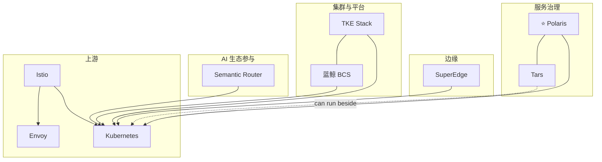

# 腾讯（Tencent）云原生开源案例（全景版）

## 一句话结论

腾讯云原生开源覆盖 **集群发行（TKE）、边缘（SuperEdge）、服务治理（Polaris）、蓝鲸容器服务（BCS）与传统微服务框架（Tars）**；近年在 AI 路由侧也有深度参与（如 Semantic Router）。

## 分层视角

| 层 | 代表项目 |
| --- | --- |
| 集群发行 / 容器平台 | `tkestack/tke`, `TencentBlueKing/bk-bcs` |
| 边缘 | `superedge` |
| 服务发现与治理 | `polarismesh/polaris` |
| 微服务框架 | `TarsCloud/Tars` |
| AI 生态参与 | `vllm-project/semantic-router` |
| 上游深度参与 | Kubernetes, Istio, Envoy |

## 可编辑全景图（Mermaid）

## 发起/主导项目（代表）

- [TarsCloud/Tars](https://github.com/TarsCloud/Tars)
- [tkestack/tke](https://github.com/tkestack/tke)
- [superedge/superedge](https://github.com/superedge/superedge)
- [polarismesh/polaris](https://github.com/polarismesh/polaris)
- [TencentBlueKing/bk-bcs](https://github.com/TencentBlueKing/bk-bcs)

## 深度参与项目（代表）

- [kubernetes/kubernetes](https://github.com/kubernetes/kubernetes)
- [istio/istio](https://github.com/istio/istio)
- [envoyproxy/envoy](https://github.com/envoyproxy/envoy)
- [vllm-project/semantic-router](https://github.com/vllm-project/semantic-router)
